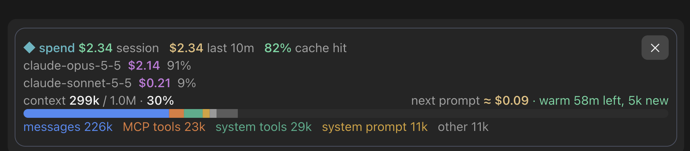

# claude-cost-bar

A [Claude Code mod](https://claude.com/blog/claude-code-mods) that adds a live **spend and context band above the prompt**. Type `/spend` to show it, click ✕ to hide it. It is built for people who switch between models (Claude and GPT through an Azure/OpenAI-compatible proxy) and want to see what each prompt will really cost, including the cache.



## What it shows

- **Spend:** session total, spend in the last 10 minutes, and cache-hit %.
- **Per model:** one row per model with its cost and share of the total, so mid-session model switches add up correctly.
- **Context:** a rounded, full-width bar split into messages, MCP tools, system tools, system prompt and other, coloured like `/usage`, with token counts.
- **Next prompt:** an estimate of what your next prompt will cost, and whether the cache is **warm** (with time left) or **cold** (and how much would be re-cached).

Each turn is priced from the API's own token counts: uncached input, output, cache reads and cache writes, each at the rate of the model that answered. Subagent turns are counted too.

## Install

In Claude Code (CLI or desktop app):

```
/plugin marketplace add tsruu/claude-cost-bar
/plugin install cost-bar@trishan-mods
```

Then start a new session and type `/spend`. Plugins load when a session starts, so already-open chats need a restart.

On a remote host (SSH sessions run Claude Code on that machine), install it there too.

## How the cache estimate works

Caches are per model, and a cache expires after its time-to-live. The estimate follows what I measured in real saved sessions:

- Switching to a model that has not answered yet starts **cold**: the whole context is written at that model's cache-write price.
- A detour through a **GPT** model leaves a Claude cache intact.
- A turn from a **different Claude** model breaks the Claude cache you left: only the system prompt, tools and MCP prefix are read back, and the rest is re-written. A Sonnet → Opus → Sonnet round trip re-cached ~250k tokens in my logs.
- The estimate adds an average output size and number of tool steps from your last few turns on the same model. It does not include the length of the prompt you are about to type.

## Prices and assumptions

All figures are **API-equivalent estimates, not a bill**. Prices live in one table at the top of [`cost-bar/hooks/register.tsx`](cost-bar/hooks/register.tsx); edit it to match your plan.

- Claude prices come from Anthropic's published pricing page. Cache writes use the **1-hour** rate. If your cache is 5 minutes, change the write numbers (and `CLAUDE_TTL_MS`).
- Claude Code's cache lifetime depends on how you sign in (reported as 1 hour on a Claude subscription, 5 minutes on an API key). Check yours.
- The GPT-6 prices are from a third-party aggregator that reads the Azure Retail Prices API. Microsoft's own pricing page did not list them when this was written. Verify against your Azure pricing.
- Long-context tiers are included for GPT-6 (above 272k tokens) and Claude Haiku 5.5 (above 100k).
- A model that is not in the table is counted as $0 and the band says so.
- Requests that fail (for example rate-limit errors) report no usage and count as $0.

## Limits

- Totals are per session and reset when the session id changes (for example after a rewind or restart).
- Typing `/spend` leaves the command line in the chat. A mod can hide its output but not the typed command.
- Tested on Claude Code 2.1.308 (desktop app). Mods are new; the API may change.

## License

MIT
